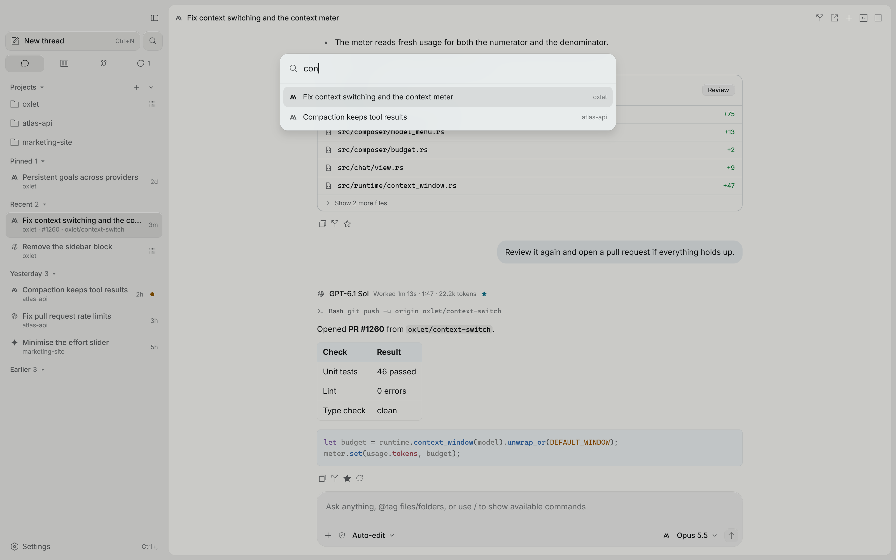
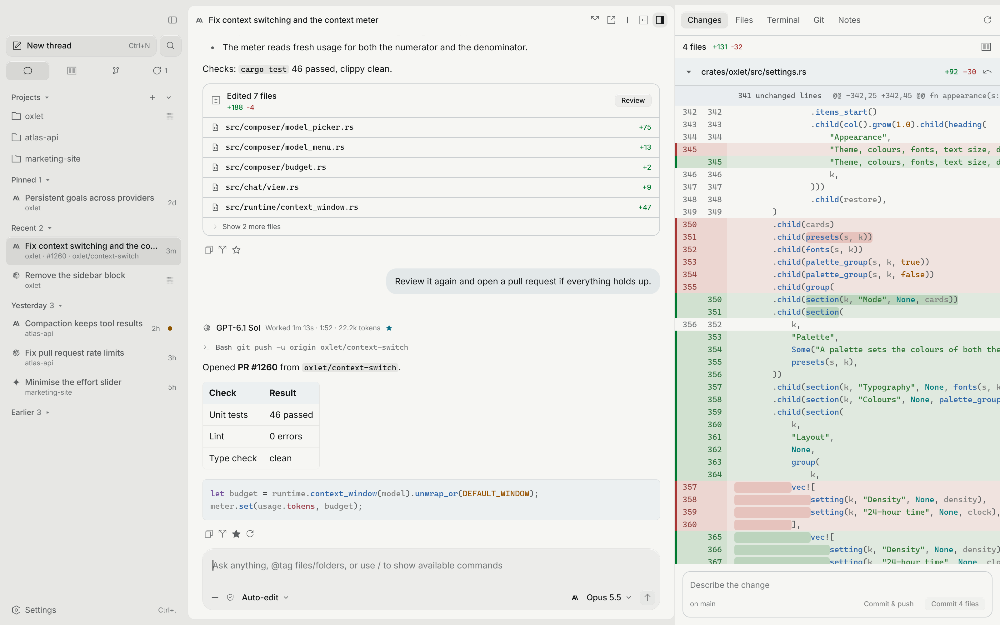

# Oxlet

A native workspace for coding agents. Oxlet runs the agent CLIs you already use, such as Claude Code and Codex, and keeps their threads, diffs, terminal and git next to each other in one fast window.

Oxlet is written in Rust on [Rune](https://github.com/anomalyco/rune), a GPU-rendered UI framework. There is no browser engine, no Node process and no server. Each agent runs as a child process and streams into the window.


## What it does

- **A start, not a blank page.** New threads open with starter prompts for mapping a codebase, finding a bug, writing tests or reviewing changes.
- **Command palette.** ⌘K finds any thread or project and runs any action: new threads, screens, panels, appearance and slash commands.
- **Projects and threads.** Add a project folder and start threads in it. Threads are grouped as Pinned, Recent, Yesterday and Earlier, searchable with ⌘K, and can be pinned, renamed, forked, marked done or archived from their context menu.
- **Agents you already have.** Claude Code, Codex, Cursor's agent, OpenCode, Gemini CLI and Factory Droid, detected on your `PATH` or at a path you set. Choose the provider, model and reasoning effort per thread. Codex offers GPT-6.1 Sol, GPT-6.1 Terra, GPT-6 Astra and GPT-6 Luna; Claude Code offers Opus 5.5, Sonnet 5.5, Haiku 5.5 and Fable 5.2. Any other model id a CLI accepts can be added in Settings.
- **Live transcripts.** Claude replies stream in word by word. Tool steps fold into a compact list and edited files show as a card with line counts. Each reply names the agent and model that wrote it and has copy, fork-from-here and pin actions.
- **Cost and tokens.** Each reply shows the tokens it used, and the cost when the CLI reports one; Notes totals the thread.
- **Retry and edit.** Run the latest prompt again, or edit any message you sent: the thread rewinds to it and continues from your new version.
- **Sessions that continue.** Each thread resumes its agent session. Switch a thread to another provider and Oxlet hands over the conversation so far.
- **Queued follow-ups.** Send while the agent works; the message waits above the composer and runs next. Remove it before it runs if you change your mind.
- **Access modes.** *Read only* plans without changing anything, *Auto-edit* lets the agent edit files but blocks risky commands, and *Full access* runs anything without asking.
- **Managed worktrees.** Start a thread in its own git worktree and branch, so parallel threads never touch the same checkout.
- **Your tools.** Open the project in VS Code, Cursor, Zed, Windsurf or Sublime Text, or reveal it in the file manager. Drop files on the composer to mention them, or folders on the sidebar to add projects. A notification tells you when a background thread finishes.
- **Review dock.** Changes (a split or unified diff with discard and commit), Files (open one to mention it as `@path`), Terminal, Git (branches, push, pull request, history) and Notes (thread goal, pinned replies, notes).
- **Slash commands.** `/fork`, `/side`, `/export`, `/goal`, `/plan`, `/debug`, `/default`, `/review`, `/compact`, `/clear`, `/model`, `/status`, `/rename`, `/automation`.
- **Board, pull requests and automations.** See every thread by status, browse the repository's pull requests through the GitHub CLI, and schedule recurring agent runs.
- **Appearance.** System, light or dark. Four palettes (Patina, Kiln, Cobalt, Graphite) or your own accent, background and foreground. Interface and code fonts (built in, the system's, or any installed font), four text sizes, compact or comfortable density, and 12- or 24-hour time.

| | |
|---|---|
|  |  |
|  |  |
|  |  |


## Install

Download the build for your system from the [latest release](https://github.com/jolovicdev/oxlet/releases/latest), or from the artifacts of the newest [CI run](https://github.com/jolovicdev/oxlet/actions/workflows/ci.yml):

| System | File |
|---|---|
| Windows x64 | `oxlet-windows-x64.zip` with `Oxlet.exe` |
| macOS, Apple silicon | `oxlet-macos-arm64.zip` with `Oxlet.app` |
| macOS, Intel | `oxlet-macos-x64.zip` with `Oxlet.app` |
| Linux x64 | `oxlet-linux-x64.tar.gz` with `oxlet` |

The macOS app is signed ad hoc, not notarised. The first time, right-click Oxlet.app and choose Open.

### What Oxlet needs

- At least one agent CLI, installed and signed in: [Claude Code](https://docs.anthropic.com/en/docs/claude-code) (`claude`) or [Codex](https://github.com/openai/codex) (`codex`), for example. Run each once in a terminal to sign in. On Windows, npm's `claude.cmd` and `codex.cmd` shims are found automatically.
- Git, for diffs, branches and worktrees.
- The [GitHub CLI](https://cli.github.com) (`gh`), signed in, for the pull request list and *Create pull request*.

If a CLI lives somewhere unusual, set its path in **Settings → Agent providers**.

## Keyboard

| Action | macOS | Windows and Linux |
|---|---|---|
| New thread | ⌘N | Ctrl+N |
| Command palette | ⌘K | Ctrl+K |
| Open thread 1 to 9 | ⌘1 … ⌘9 | Ctrl+1 … Ctrl+9 |
| Previous / next thread | ⌥↑ / ⌥↓ | Alt+↑ / Alt+↓ |
| Settings | ⌘, | Ctrl+, |
| Toggle sidebar | ⇧⌘B | Ctrl+Shift+B |
| Toggle review dock | ⌘J | Ctrl+J |
| Terminal | ⌘` | Ctrl+` |
| Send / new line | Return / Shift+Return | Enter / Shift+Enter |
| Stop the running turn | Esc | Esc |

## Your data

Oxlet keeps everything in one file, `~/.oxlet/workspace.json` (`%USERPROFILE%\.oxlet` on Windows), written on a background thread a moment after each change. Set `OXLET_HOME` to keep it elsewhere. Exports from `/export` go to `~/.oxlet/exports`, and managed worktrees to `~/.oxlet/worktrees` unless you choose another folder.

## Build from source

You need stable Rust (Oxlet is built and tested with 1.97). On Linux, install the window system headers first:

```bash
sudo apt-get install -y libxkbcommon-dev libwayland-dev
```

Then build and run:

```bash
cargo run --release -p oxlet
```

`cargo run -p oxlet -- demo` opens a sample workspace without touching your own.

## Development

```bash
cargo test --workspace
```

The tests drive the real interface through Rune's headless runtime. Stand-in `claude` and `codex` scripts speak each CLI's streaming format, so the tests cover sending, streaming, tool steps, edit tracking, session resume, provider handoff, queued messages, worktrees, stopping and slash commands without an account.

Debug builds, and release builds with `--features tooling`, render headlessly for checking the interface:

```bash
cargo run -p oxlet -- --list-scenes
cargo run -p oxlet -- --snap thread.png --scene dark --size 1730x1090
cargo run -p oxlet -- --tree tree.json --scene dock
```

On a machine without a GPU, point Vulkan at Mesa's software driver: `VK_ICD_FILENAMES=/usr/share/vulkan/icd.d/lvp_icd.json`.

### Layout

- `crates/oxlet-core`: the workspace model, JSON storage, provider command lines and stream parsers, process and git runners, slash commands, schedules and export. No UI.
- `crates/oxlet`: the Rune app. `state.rs` holds the app state and the bridge that carries worker results to the UI thread, `actions.rs` everything that changes state, and one file per surface: `sidebar.rs`, `thread.rs`, `composer.rs`, `dock.rs`, `pages.rs`, `settings.rs`.

Every process, git call and disk write runs on a worker thread. The UI thread only applies results, so the window never waits on an agent, a repository or the disk.

## License

MIT
