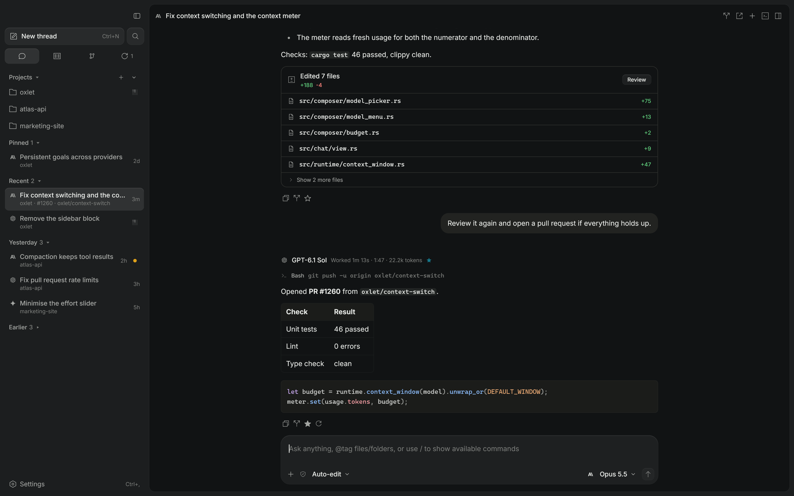
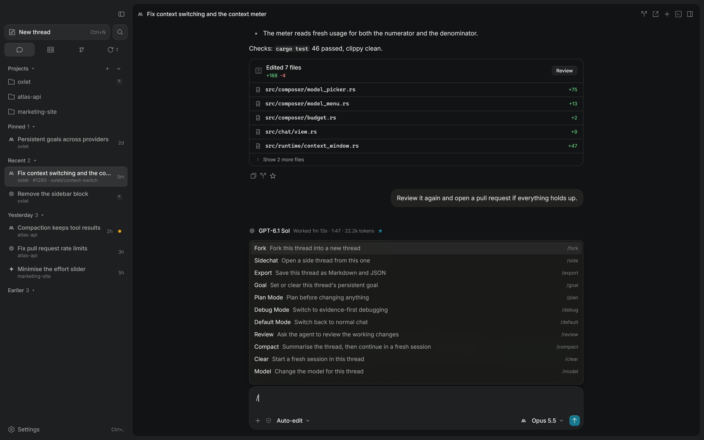
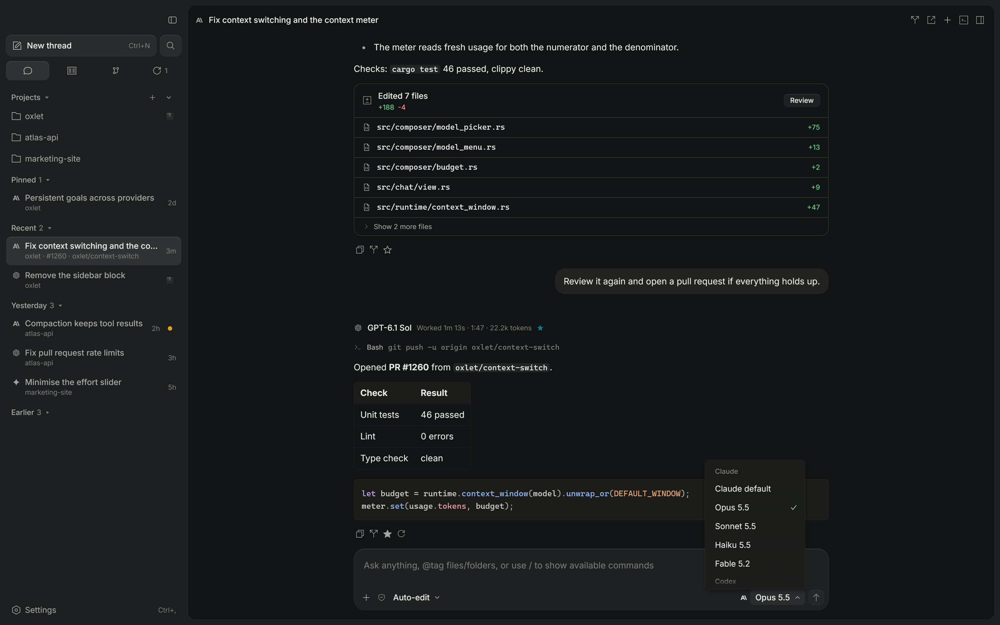
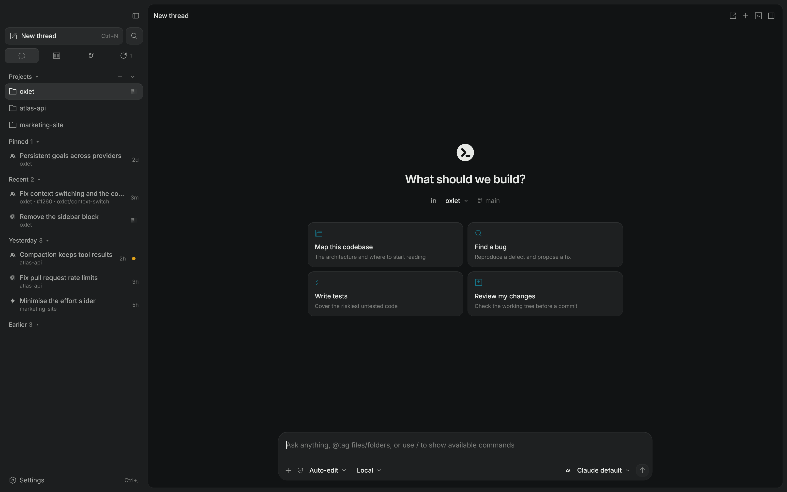
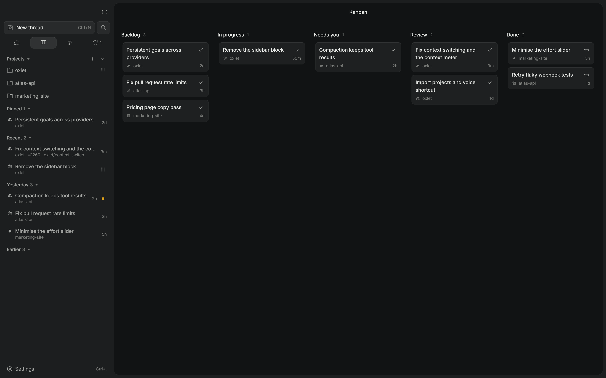
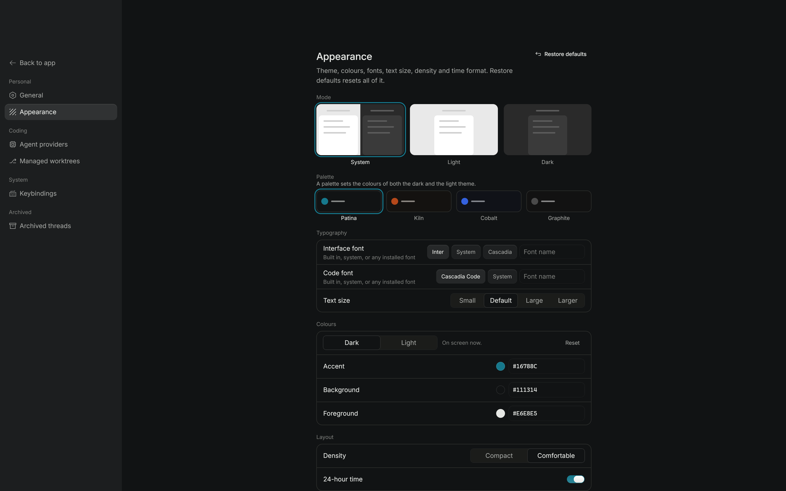

# Oxlet

Oxlet is a desktop app for working with coding agents. It runs the agent CLIs you already have, such as Claude Code and Codex, and puts their conversations next to the things you need while they work: the diff, the files, a terminal and git.

It is a native app written in Rust on [Rune](https://github.com/anomalyco/rune). There is no browser engine inside it and no server behind it. Each agent is a child process on your machine, or on a machine you point it at.



## Using it

Add a project folder and start a thread in it. A thread is one conversation with one agent about that project. You pick the agent, the model and how much it is allowed to do: *Read only* plans without changing anything, *Auto-edit* edits files but holds back risky commands, and *Full access* runs whatever it decides to. A new thread can run in the project folder or in its own git worktree and branch, so several threads can work on the same repository without touching each other's files.

Replies stream in as they are written. Tool calls fold into a short list, edited files appear as a card with their line counts, and each reply shows which agent and model wrote it, how long it took and what it cost in tokens. You can send a follow-up while the agent is still working and it waits its turn. If a reply goes wrong, run the prompt again or edit any message you sent and continue from there. Switching a thread to a different agent hands it the conversation so far.

The review dock on the right is where you check the work. *Changes* shows the diff, split or unified, and lets you discard a file or commit. *Files* browses the project, *Terminal* runs commands in it, *Git* covers branches, push, history and opening a pull request, and *Notes* keeps the thread's goal, pinned replies and your own notes. Anything that destroys work, such as discarding a file or deleting a thread, asks first.

Outside a single thread there is a board of every thread by status, the repository's pull requests, and automations that start an agent on a schedule. The command palette (⌘K or Ctrl+K) reaches any thread, project or action, and typing `/` in the message box lists commands such as `/plan`, `/review`, `/fork`, `/compact` and `/export`.

| | |
|---|---|
|  |  |
|  |  |
|  |  |

## Install

Download the installer for your system from the [latest release](https://github.com/jolovicdev/oxlet/releases/latest):

| System | Installer | Portable |
|---|---|---|
| Windows x64 | `oxlet-windows-x64-setup.exe` | `oxlet-windows-x64.zip` |
| macOS, Apple silicon | `oxlet-macos-arm64.dmg` | `oxlet-macos-arm64.zip` |
| macOS, Intel | `oxlet-macos-x64.dmg` | `oxlet-macos-x64.zip` |
| Debian and Ubuntu, x64 | `oxlet-linux-x64.deb` | `oxlet-linux-x64.tar.gz` |

The Windows installer needs no administrator rights and adds Oxlet to the Start menu. The builds are not code-signed yet: Windows SmartScreen asks you to confirm the first run, and on macOS you right-click Oxlet.app and choose Open the first time.

Oxlet does not include an agent. Install at least one agent CLI and sign in to it by running it once in a terminal: [Claude Code](https://docs.anthropic.com/en/docs/claude-code) (`claude`) and [Codex](https://github.com/openai/codex) (`codex`) have the fullest support, and Cursor's agent, OpenCode, Gemini CLI and Factory Droid also work. Oxlet finds them on your `PATH`; if one lives somewhere else, set its path in Settings → Agent providers. You also need Git, and the [GitHub CLI](https://cli.github.com) (`gh`) if you want the pull request list.

## Projects in WSL and over SSH

A project does not have to be on the machine Oxlet runs on. It can be a folder inside a WSL distro or on a server you reach with SSH. The agent, git, the terminal and worktrees then all run there, and Oxlet shows the results.

*Add project* opens your system's folder dialog. The arrow beside it offers a WSL distro, an SSH host or a typed path. You can also type `\\wsl.localhost\<distro>\path`, `user@host:/path` or `ssh://user@host/path` directly.

WSL projects need Oxlet running on Windows. SSH projects use your system's `ssh` with key-based sign-in, so the key has to work without a password prompt. In both cases the agent CLI must be installed and signed in on that machine, and on the `PATH` your login shell sets up in `~/.profile`. A `PATH` that is only set in `~/.bashrc`, which is what nvm does, is not picked up.

## Keyboard

| Action | macOS | Windows and Linux |
|---|---|---|
| New thread | ⌘N | Ctrl+N |
| Command palette | ⌘K | Ctrl+K |
| Open thread 1 to 9 | ⌘1 … ⌘9 | Ctrl+1 … Ctrl+9 |
| Previous / next thread | ⌥↑ / ⌥↓ | Alt+↑ / Alt+↓ |
| Settings | ⌘, | Ctrl+, |
| Toggle sidebar | ⇧⌘B | Ctrl+Shift+B |
| Toggle review dock | ⌘J | Ctrl+J |
| Terminal | ⌘` | Ctrl+` |
| Send / new line | Return / Shift+Return | Enter / Shift+Enter |
| Stop the running turn | Esc | Esc |

## Appearance

Oxlet follows your system's light or dark setting, or stays on one. There are four palettes (Patina, Kiln, Cobalt and Graphite), and you can set your own accent, background and text colours for each theme. Fonts, text size, density and the clock format are in the same place.



## Your data

Everything Oxlet knows is in one file on your machine, `~/.oxlet/workspace.json` (`%USERPROFILE%\.oxlet` on Windows). Set `OXLET_HOME` to keep it somewhere else. Thread exports go to `~/.oxlet/exports` and managed worktrees to `~/.oxlet/worktrees`, unless you choose another folder in Settings.

## Building from source

You need stable Rust. On Linux, install the window system headers first:

```bash
sudo apt-get install -y libxkbcommon-dev libwayland-dev
```

```bash
cargo run --release -p oxlet
```

`cargo run -p oxlet -- demo` opens a sample workspace without touching your own, and `cargo test --workspace` runs the tests. They drive the real interface headlessly against stand-in agent scripts, so they need no account.

The code is two crates. `crates/oxlet-core` holds the workspace model, storage, the agent command lines and stream parsers, and the process and git runners. `crates/oxlet` is the interface. Processes, git calls and disk writes run on worker threads, and the interface thread only applies their results.

## How it was made

A good part of Oxlet's code was written by Claude, Anthropic's AI model, working from Dušan Jolović's direction and review.

## License

MIT
